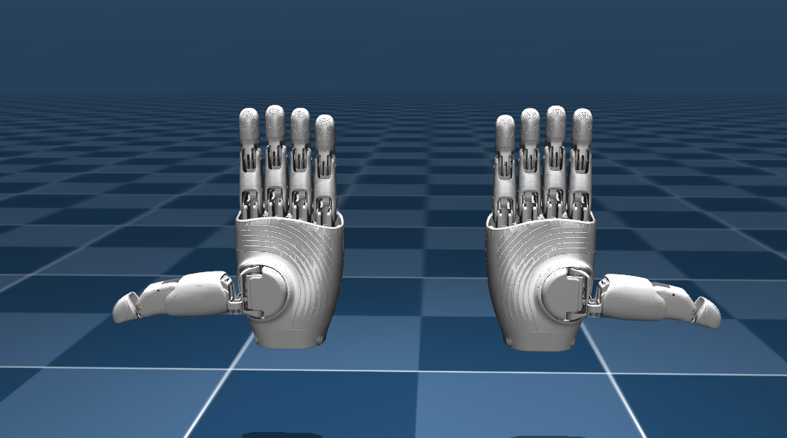

[中文说明](README_CN.md)

# OmniHand 2025 (O10) ROS 2 Package

This is the `omnihand_2025_description` ROS 2 package for **OmniHand 2025 (O10)**. It includes the URDF files for both the left and right hands, along with visualization support in RViz. The recommended ROS 2 distribution for using this package is **Humble**.

## File Structure

```text
omnihand_2025_description/
├── CMakeLists.txt
├── package.xml
├── launch/          # ROS 2 visualization launch files
├── urdf/            # Primitive collision models and xacro/ sources
├── urdf_mesh_col/   # Convex collision models and xacro/ sources
├── meshes/          # STL meshes, with collision meshes in collision/
├── rviz/            # RViz configurations
└── mjcf/            # MuJoCo models and scenes
```

Resource directories are installed under `share/omnihand_2025_description/` with the same layout.
Earlier versions used the ROS package name `omnihand_description` and kept resources under `assets/`. Projects using those versions need to update the package name and source paths. Joint names, model filenames, and model parameters are unchanged.

## Installation

### 1. Clone the Repository
Create a new `src` directory, navigate into it, and clone the repository:

```bash
mkdir -p ~/omnihand_ws/src
cd ~/omnihand_ws/src
git clone <repository_url> omnihand_2025_description
cd ..
```

### 2. Build the Package
Build the workspace using:

```bash
rosdep install --from-paths src --ignore-src -r -y
colcon build
```

### 3. Source the Setup File
Before using the package, source the workspace setup file:

```bash
source install/setup.bash
```

## Generate OmniHand URDF File

To generate the URDF description from the Xacro files:

```bash
cd ~/omnihand_ws/src/omnihand_2025_description/urdf
xacro xacro/omnihand_right.xacro > omnihand_right.urdf
xacro xacro/omnihand_left.xacro > omnihand_left.urdf
```

## Visualization in RViz

### Right Hand
```bash
ros2 launch omnihand_2025_description omnihand_description.launch.py
```

### Left Hand
```bash
ros2 launch omnihand_2025_description omnihand_description.launch.py hand_type:=left
```

## High Precision Collision URDF
This package additionally provides a collision-optimized URDF model, generated using convex optimization over original hand mesh geometry.
Compared to standard primitive collision approximations, this version produces more accurate physical interaction.

The convex collision URDF is located at:
omnihand_2025_description/urdf_mesh_col/

### Right Hand With Accurate Collision
```bash
ros2 launch omnihand_2025_description omnihand_description_col.launch.py
```

### Left Hand With Accurate Collision
```bash
ros2 launch omnihand_2025_description omnihand_description_col.launch.py hand_type:=left
```

> **Note on Joint Coupling Accuracy**\
> URDF only supports **linear coupling** between passive and active
> joints.\
> However, OmniHand's mechanical structure uses **nonlinear
> coupling** for most passive joints, making it impossible for the URDF
> model to fully match the real hardware behavior.\
> If you need to simulate the **true nonlinear coupling**, please refer
> to:
> - The **MuJoCo MJCF model**, which contains accurate nonlinear mappings
> - The **OmniHand SDK**, which provides real coupling functions

------------------------------------------------------------------------

## MuJoCo MJCF Files

This package also provides **MuJoCo MJCF models** for simulating OmniHand in physics-based environments.\
The MJCF files are compatible with **MuJoCo 3.1.0 and later**.

Model files are located at:

```
omnihand_2025_description/mjcf/
```

This directory includes:

- `scene.xml` – A complete scene file for quick preview\
- `omnihand_left.xml` – Left-hand model\
- `omnihand_right.xml` – Right-hand model\
- `omnihand_asset.xml` – Mesh resources and simulation defaults

The STL mesh assets are located in `../meshes/`.

### Quick Preview

To quickly preview the OmniHand model:

1. Open MuJoCo’s `simulate` viewer\
2. Drag and drop `mjcf/scene.xml` into the window
3. The OmniHand model will automatically load and display

Example:


