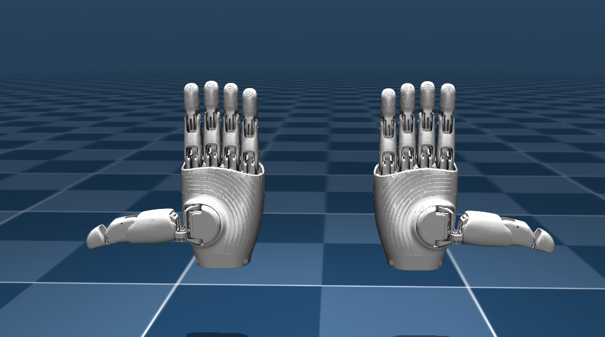

[English Version](README.md)

# OmniHand 2025 (O10) ROS 2 软件包

这是一个用于 **OmniHand 2025 (O10)** 的 ROS 2 软件包，包名为 `omnihand_2025_description`，包含左右手的 URDF 模型文件，并支持在 RViz 中可视化显示。推荐使用的 ROS 2 版本为 **Humble**。

## 文件结构

```text
omnihand_2025_description/
├── CMakeLists.txt
├── package.xml
├── launch/          # ROS 2 可视化启动文件
├── urdf/            # 普通碰撞模型及 xacro/ 源文件
├── urdf_mesh_col/   # 凸分解碰撞模型及 xacro/ 源文件
├── meshes/          # STL 网格，collision/ 下为碰撞网格
├── rviz/            # RViz 配置
└── mjcf/            # MuJoCo 模型与场景
```

资源目录安装到 `share/omnihand_2025_description/` 下，保持相同目录结构。
旧版 ROS 包名为 `omnihand_description`，资源位于 `assets/` 下；使用旧版的项目需要更新包名和源码路径。关节名称、模型文件名及模型参数保持不变。

## 安装指南

### 1. 克隆仓库

创建工作空间并克隆仓库：

```bash
mkdir -p ~/omnihand_ws/src
cd ~/omnihand_ws/src
git clone <repository_url> omnihand_2025_description
cd ..
```

### 2. 编译工作空间

运行以下命令进行编译：

```bash
rosdep install --from-paths src --ignore-src -r -y
colcon build
```

### 3. 加载环境

在使用前，需要加载工作空间的环境配置：

```bash
source install/setup.bash
```

## 生成 OmniHand 的 URDF 文件

通过 Xacro 文件生成 URDF：

```bash
cd ~/omnihand_ws/src/omnihand_2025_description/urdf
xacro xacro/omnihand_right.xacro > omnihand_right.urdf
xacro xacro/omnihand_left.xacro > omnihand_left.urdf
```

## RViz 可视化

### 显示右手模型
```bash
ros2 launch omnihand_2025_description omnihand_description.launch.py
```

### 显示左手模型
```bash
ros2 launch omnihand_2025_description omnihand_description.launch.py hand_type:=left
```

## 更加精确的碰撞 URDF 模型
本包额外提供基于原始 mesh 进行 凸分解优化 的碰撞模型 URDF，用于实现更真实、更精确的物理接触效果。
相比常规基于 box/sphere 的碰撞建模，该模型可显著提高碰撞检测的准确性。

高精度碰撞模型位于：
omnihand_2025_description/urdf_mesh_col/

### 显示右手（精确碰撞模型）
```bash
ros2 launch omnihand_2025_description omnihand_description_col.launch.py
```

### 显示左手（精确碰撞模型）
```bash
ros2 launch omnihand_2025_description omnihand_description_col.launch.py hand_type:=left
```

> **关于关节耦合精度的说明**\
> URDF 仅支持 **线性耦合**，而 OmniHand
> 的大部分被动关节与主动关节之间是 **非线性耦合**。\
> 因此，URDF 模型无法完全复现真实机械手的耦合行为。\
> 若需要模拟真实耦合关系，请参考：
> - **MuJoCo 的 MJCF 模型**（已包含真实非线性映射）
> - **OmniHand SDK**（计算真实耦合关系）

------------------------------------------------------------------------

## MuJoCo MJCF 文件

本包也提供 **MuJoCo MJCF 模型**，可用于在物理仿真环境中模拟 OmniHand。\
MJCF 文件兼容 **MuJoCo 3.1.0 及以上版本**。

模型路径：

```
omnihand_2025_description/mjcf/
```

包含以下内容：

- `scene.xml` – 完整场景文件，可快速预览\
- `omnihand_left.xml` – 左手 MJCF 模型\
- `omnihand_right.xml` – 右手 MJCF 模型\
- `omnihand_asset.xml` – 网格资源和仿真默认配置

对应的 STL 网格文件位于 `../meshes/`。

### 快速预览方式

1. 打开 MuJoCo 自带的 `simulate` 查看器\
2. 将 `mjcf/scene.xml` 拖入窗口
3. 模型会自动加载并显示\

示例：


